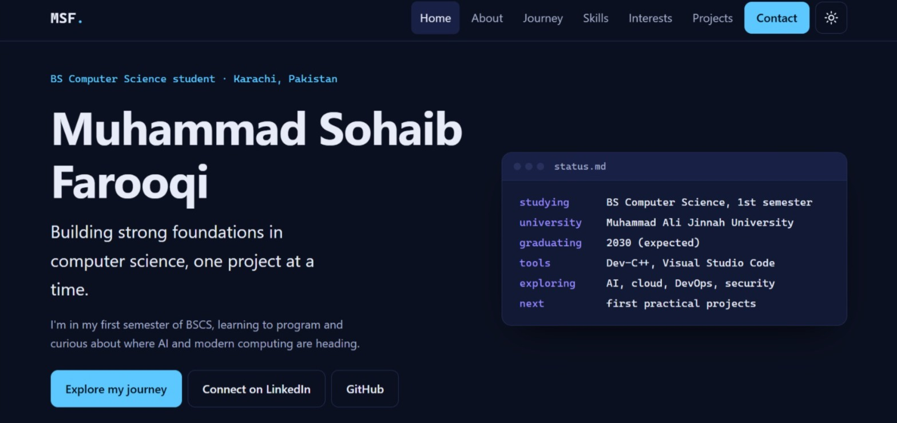

# Muhammad Sohaib Farooqi — Personal Portfolio Website


**Live Demo:** [View Portfolio Website](https://muhammad-sohaib-farooqi.github.io/muhammad-sohaib-farooqi-portfolio/)

**Repository:** [muhammad-sohaib-farooqi-portfolio](https://github.com/muhammad-sohaib-farooqi/muhammad-sohaib-farooqi-portfolio)

---

## Portfolio Preview



*Preview of the personal portfolio website.*

---

## About the Project

A responsive personal portfolio website built with **HTML5, CSS3, and vanilla JavaScript**.

The website introduces Muhammad Sohaib Farooqi, a first-semester BS Computer Science student, and provides a professional space to present his academic background, technical interests, and future programming projects.

The project focuses on clean design, responsive layouts, interactive functionality, accessibility-conscious practices, and maintainable frontend code.

## Features

* Responsive layout for desktop, tablet, and mobile screens
* Sticky navigation with a mobile-friendly menu
* Mobile menu that supports closing with the Escape key
* Dark and light theme toggle
* Theme preference saved using `localStorage`
* Scroll progress indicator and subtle reveal animations
* Reduced-motion preference support
* Semantic HTML structure
* Visible keyboard focus indicators
* Content designed to remain readable without JavaScript
* Project information maintained in a separate JavaScript file
* Custom 404 error page
* `robots.txt` and `sitemap.xml`
* Lightweight implementation without frontend frameworks or package dependencies

## Technologies Used

**Frontend**

* HTML5
* CSS3 — custom properties, Grid, and Flexbox
* Vanilla JavaScript (ES6+)

**Browser APIs**

* Local Storage API
* Intersection Observer API

**Tools and Hosting**

* Git and GitHub
* GitHub Pages
* Visual Studio Code or another code editor

## Project Structure

```text
muhammad-sohaib-farooqi-portfolio/
│
├── assets/
│   ├── css/
│   │   └── style.css
│   ├── favicon/
│   │   ├── favicon.svg
│   │   └── portfolio-preview.png
│   ├── images/
│   │   └── README.md
│   └── js/
│       ├── main.js
│       └── projects-data.js
│
├── docs/
│   └── DEPLOYMENT.md
│
├── .gitignore
├── 404.html
├── index.html
├── LICENSE
├── README.md
├── robots.txt
└── sitemap.xml
```

## Getting Started

No package installation or build process is required.

### 1. Clone the repository

```bash
git clone https://github.com/muhammad-sohaib-farooqi/muhammad-sohaib-farooqi-portfolio.git
```

### 2. Open the project folder

```bash
cd muhammad-sohaib-farooqi-portfolio
```

### 3. Run locally

Open `index.html` in a modern web browser.

Alternatively, start a local server using Python:

```bash
python -m http.server 8000
```

Open `http://localhost:8000` in your browser. Press `Ctrl + C` in the terminal to stop the server.

## Key Functionality

### Dark and Light Themes

Visitors can switch between themes, with their preference saved in browser `localStorage`.

### Responsive Navigation

The navigation adapts to smaller screens and supports closing the mobile menu with the Escape key.

### Scroll Interactions

A scroll progress indicator and reveal effects provide subtle visual feedback. Reduced-motion preferences are considered.

### Project Management

Project information is maintained in `assets/js/projects-data.js`, allowing the project list to be updated separately from the main JavaScript functionality.

## Accessibility Considerations

The project incorporates several accessibility-conscious practices:

* Semantic HTML elements
* Keyboard navigation support
* Visible focus indicators
* Escape-key support for the mobile menu
* Reduced-motion preferences
* Responsive layouts
* Content designed to remain readable without JavaScript

These practices do not constitute a formal WCAG compliance claim. Further manual testing and accessibility evaluation are recommended.

## Deployment

The website is hosted using **GitHub Pages**.

**Live Website:**
https://muhammad-sohaib-farooqi.github.io/muhammad-sohaib-farooqi-portfolio/

To configure deployment:

1. Open the repository's **Settings**.
2. Select **Pages**.
3. Under **Build and deployment**, choose `Deploy from a branch`.
4. Select the `main` branch and `/(root)` folder.
5. Click **Save**.
6. Check the Pages section for deployment status.

For additional information, see [docs/DEPLOYMENT.md](docs/DEPLOYMENT.md).

## Customization and Future Development

The portfolio can be extended as new skills and projects are developed.

* **Personal information:** Update `index.html`.
* **Styling:** Modify `assets/css/style.css`.
* **JavaScript functionality:** Update `assets/js/main.js`.
* **Project listings:** Edit `assets/js/projects-data.js`.
* **Images:** Add relevant images to `assets/images/`.
* **Deployment:** Refer to `docs/DEPLOYMENT.md`.

Only genuine projects, completed work, and accurate achievements should be presented.

## Testing Checklist

The following checks are recommended before wider use:

* [ ] Test desktop, tablet, and mobile layouts.
* [ ] Check for unintended horizontal scrolling.
* [ ] Verify navigation links.
* [ ] Test the mobile menu using the keyboard.
* [ ] Confirm Escape closes the mobile menu.
* [ ] Verify theme persistence after refreshing.
* [ ] Test behavior with JavaScript disabled.
* [ ] Check the browser console for errors.
* [ ] Verify that links and assets load correctly.
* [ ] Test focus visibility and reduced-motion behavior.

These are recommended checks; their inclusion does not mean that all tests have been completed.

## Known Limitations

* The website is static and does not use a backend.
* No contact form is currently included.
* Project listings need to be updated as genuine projects are completed.
* Formal accessibility audits and comprehensive cross-browser testing have not been performed.

## Author

**Muhammad Sohaib Farooqi**
First-Semester BS Computer Science Student
Karachi, Pakistan

Interested in programming, practical project development, and building a strong foundation in Computer Science.

## Connect

* **GitHub:** [muhammad-sohaib-farooqi](https://github.com/muhammad-sohaib-farooqi)
* **LinkedIn:** [Muhammad Sohaib Farooqi](https://www.linkedin.com/in/-muhammad-sohaib-farooqi-/)
* **Email:** [0.sohaibfarooqi.0@gmail.com](mailto:0.sohaibfarooqi.0@gmail.com)

## License

This project is licensed under the MIT License. See the [LICENSE](LICENSE) file for details.
